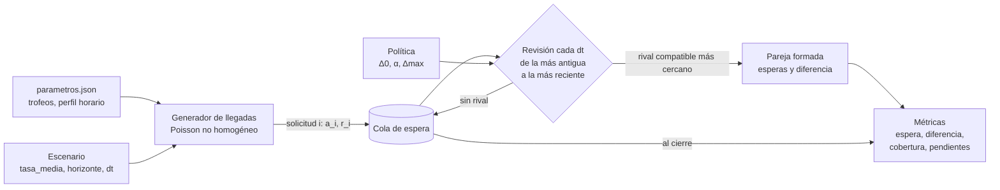

# Modelo de eventos discretos de la cola de emparejamiento

Material para la Parte 3 del informe (formulación del modelo y simulación). Código en
`src/matchmaking/simulacion/`.

## 1. Diagrama del sistema



- **Generador de llegadas**: crea las solicitudes con su hora de llegada y sus trofeos.
- **Cola**: guarda las solicitudes en espera, ordenadas por llegada y por trofeos.
- **Revisión**: aplica la política para decidir qué parejas se forman.
- **Métricas**: resumen de esperas y diferencias; es lo que comparan la optimización y los experimentos.

## 2. Variables, parámetros y unidades

| Símbolo | Código | Tipo | Unidad | Descripción | Procedencia |
|---|---|---|---|---|---|
| a_i | `llegada[i]` | entrada | s | Hora de llegada de la solicitud i | Generada |
| r_i | `r[i]` | entrada | trofeos | Trofeos de la solicitud i, fijos durante la espera | Muestreados de `trofeos_solicitudes.frecuencias` (real, 1–3 nov) |
| λ̄ | `tasa_media` | parámetro de escenario | solicitudes/s | Tasa media diaria de llegadas | Fijada como unidad de tiempo (D11) |
| p_h | `perfil_horario.peso` | parámetro | adimensional | Peso de la hora h; Σ p_h = 1 | Real, 1–4 nov (D5) |
| λ_h | — | derivado | solicitudes/s | λ_h = 24 · λ̄ · p_h | — |
| dt | `dt` | parámetro de escenario | s | Periodo de revisión de la cola | 1 s; sensibilidad con 5 s |
| T | `duracion_s` | parámetro de escenario | s | Horizonte simulado | 86,400 s (un día) |
| Δ0 | `delta0` | decisión | trofeos | Ventana inicial | Política |
| α | `alfa` | decisión | trofeos/s | Velocidad de ampliación | Política |
| Δmax | `delta_max` | decisión | trofeos | Ventana máxima | Política |
| w_i(t) | `t - llegada[i]` | estado | s | Espera acumulada de i | — |
| Q(t) | `por_trofeo`, `cola` | estado | solicitudes | Conjunto de solicitudes en espera | — |

**Salidas** (por corrida, de `simular`):

| Salida | Unidad | Definición |
|---|---|---|
| `espera_media`, `espera_p95` | s | Media y P95 de t_emparejamiento − a_i de las solicitudes medidas y emparejadas |
| `dif_media`, `dif_p90`, … | trofeos | Media y cuantiles de \|r_i − r_j\| de las parejas formadas tras el calentamiento |
| `cobertura` | proporción | Solicitudes medidas emparejadas / solicitudes medidas |
| `pendientes`, `antiguedad_*` | solicitudes, s | Las que siguen en cola al cierre y cuánto llevan esperando |
| `cola_media`, `cola_max` | solicitudes | Tamaño de la cola muestreado cada 60 s |

Las solicitudes *medidas* son las que llegan entre `calentamiento_s` (600 s) y
T − `margen_cierre_s` (300 s). Así ninguna política gana o pierde por la cola vacía del inicio ni
por las llegadas que no alcanzan a emparejarse antes del cierre. La definición es la misma para
todas las políticas.

## 3. Reglas

**Llegadas.** Proceso de Poisson no homogéneo con tasa constante λ_h dentro de cada hora:
N_h ~ Poisson(λ_h · 3600) y tiempos uniformes en la hora.

**Ventana.** Δ(w) = min(Δmax, Δ0 + α · w). Una ventana fija ±D es Δ0 = Δmax = D, α = 0.

**Compatibilidad.** i y j son compatibles en t si |r_i − r_j| ≤ min(Δ(w_i(t)), Δ(w_j(t))).
La regla es simétrica: ninguno acepta un rival más lejano que su propia ventana.

**Emparejamiento.** En cada revisión se recorre la cola de la solicitud más antigua a la más
reciente. Para cada i aún en espera se elige el j compatible con menor |r_i − r_j|; los empates se
resuelven por el j más antiguo y luego por el menor identificador.

**Supuestos.** Los trofeos no cambian durante la espera; toda pareja compatible acepta la batalla;
no hay abandono ni reingreso; los jugadores fuera de 5,000–11,999 no se simulan.

## 4. Pseudocódigo

```text
simular(política, escenario, semilla):
    rng ← generador con semilla
    (a, r) ← generar_solicitudes(escenario, parametros, rng)      # ordenadas por a
    Q ← ∅
    para t = dt, 2dt, …, T:
        agregar a Q las solicitudes con a_i ≤ t
        para i en Q en orden de llegada:
            si i ya fue emparejada en este t: continuar
            C ← { j ∈ Q, j ≠ i : |r_i − r_j| ≤ min(Δ(t − a_i), Δ(t − a_j)) }
            si C ≠ ∅:
                j* ← argmin_{j ∈ C} (|r_i − r_j|, a_j, j)
                sacar i y j* de Q; registrar t, esperas t − a_i y t − a_j*, diferencia |r_i − r_j*|
    devolver métricas sobre las solicitudes medidas
```

La implementación no revisa toda la cola en cada t. Solo examina las solicitudes cuya
compatibilidad pudo cambiar (recién llegadas, ventanas que crecieron y las que están a su alcance)
y busca al rival más cercano en una lista ordenada por trofeos. La prueba
`test_motor_igual_a_la_referencia_ingenua` comprueba que forma exactamente las mismas parejas que
el pseudocódigo.

## 5. Verificación (Parte 5)

`python -m pytest` corre:

| Prueba | Propiedad |
|---|---|
| `test_conservacion_de_solicitudes` | llegadas = 2 · parejas + pendientes |
| `test_esperas_no_negativas_y_restriccion_de_ventana` | esperas ≥ 0 y toda pareja cumple la regla de compatibilidad |
| `test_misma_semilla_mismo_resultado` | reproducibilidad con la misma semilla; resultados distintos con otra |
| `test_ventana_cero_solo_empareja_trofeos_iguales` | con Δ = 0 solo hay parejas con diferencia 0 y la cobertura cae |
| `test_ventana_infinita_equivale_a_emparejar_al_azar` | con Δ = ∞ y poca demanda, la diferencia media es E\|X − Y\| de la distribución de trofeos |
| `test_ventana_mas_amplia_reduce_la_espera` | una ventana fija más amplia reduce la espera y aumenta la diferencia |
| `test_motor_igual_a_la_referencia_ingenua` | el motor optimizado coincide con una implementación directa del pseudocódigo |
